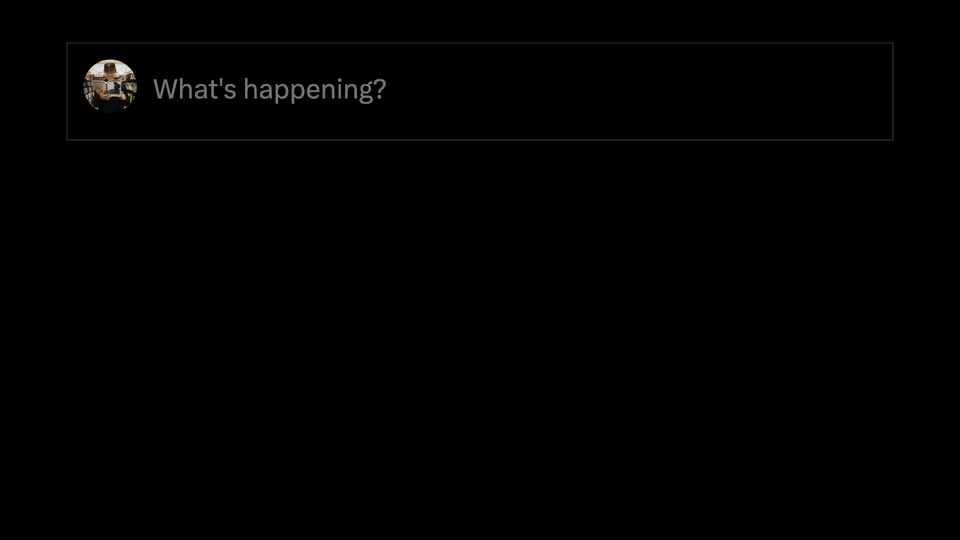
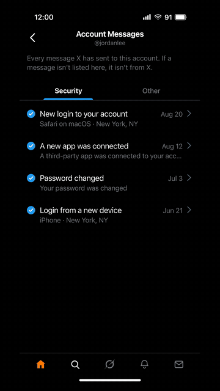

# x-improvements

my ideas for redesigning x.com, one component at a time

 

## 🧩 Components

A growing set of redesigned X components. More to come.

| Component | What it is | Try it |
|-----------|------------|--------|
| **Web Composer** | A redesigned X compose box | [Live demo](https://stevederico.github.io/x-improvements/web-composer/composer-r1/index.html) |
| **Notifications** | The notifications screen | [Live demo](https://stevederico.github.io/x-improvements/notifications/r1/index.html) |
| **Account Messages** | Every email X sent you, in the app | [Live demo](https://stevederico.github.io/x-improvements/account-messages/r1/index.html) |

 

## Ideas

Replies to [one thing you'd change on x.com](https://x.com/yagiznizipli/status/2103515711041597539).

| Idea | What it is | Status | Post |
|------|------------|--------|------|
| **Notifications** | Subscribe and unsubscribe is inconsistent, delayed, and it is hard to tell a reply from a post | [Prototype](https://stevederico.github.io/x-improvements/notifications/r1/index.html) | [link](https://x.com/stevederico/status/2103601283840270557) |
| **Account Messages** | A verified list of emails X actually sent, so phishing stands out | [Prototype](https://stevederico.github.io/x-improvements/account-messages/r1/index.html) | [link](https://x.com/stevederico/status/2103568147551035833) |
| **Web Composer** | The web compose box needs a refresh | [Prototype](https://stevederico.github.io/x-improvements/web-composer/composer-r1/index.html) | [link](https://x.com/stevederico/status/2103567854662795293) |
| **Grok on action bar** | Move the Grok button onto the post action bar (like, reply, repost) | Idea | [link](https://x.com/stevederico/status/2103567648059801986) |
| **X Resume** | A place for your resume on X, instead of LinkedIn | [hardwork.dev](https://hardwork.dev) | [link](https://x.com/stevederico/status/2103567396355314070) |
| **Follow QR** | A QR code for following people IRL | [wallpaper](https://hardwork.dev/wallpaper) | [link](https://x.com/stevederico/status/2103566936349274513) |
| **Edit replies** | Edit a reply in the first minute | Idea | [link](https://x.com/stevederico/status/2103566771265700260) |
| **X TV** | A TV app for X video | [Watch X](https://watch.grok.me) | [link](https://x.com/stevederico/status/2103566182389539100) |

 

## ✍️ Web Composer

A self-contained HTML/JS prototype of a redesigned X compose box.

**[▶ Try the live demo](https://stevederico.github.io/x-improvements/web-composer/composer-r1/index.html)**

  

**Improvements**

- **fullscreen mode** — floating close button in upper right, Cmd+. to toggle, persistent toolbar, Escape to exit
- **icons on focus** — toolbar stays hidden until you focus the editor
- **generate image** — custom Grok image-generation icon added to the toolbar
- **no dropdowns in writing area** — audience and "who can reply" (6 options) folded into a single toolbar popup with live label sync
- **no counter for premium** — character count inlined and shown based on Free/Premium (hard 280 limit in Free mode)
- **no bold for usernames + links** — bold/italic only applies to formattable text, not usernames or links

Lives in `web-composer/` — a frozen `baseline` plus the working `composer-r1` revision.

 

## 🛎️ Notifications

A self-contained HTML/JS prototype of the X notifications screen (All / Verified / Mentions tabs).

**[▶ Try the live demo](https://stevederico.github.io/x-improvements/notifications/r1/index.html)**

**Improvements**

- **subscribe / unsubscribe** — inconsistent, delayed, and it is hard to tell a reply from a post

Lives in `notifications/` — a frozen `baseline/` (current X from console dump) plus the working `r1/` revision with tabs, mark-read, simulate new, etc.

 

## 📬 Account Messages

A new screen under Security and account access that lists every message X has sent to the account. If an email isn't listed here, it isn't from X.

**[▶ Try the live demo](https://stevederico.github.io/x-improvements/account-messages/r1/index.html)**

  

**Improvements**

- **phishing check** — compare any email in your inbox against the real list in the app
- **security and other tabs** — logins, connected apps and password changes kept apart from everything else
- **verified sender** — each message shows it was sent by X with a Mark Certificate
- **one tap from settings** — sits next to Security, Apps and sessions, and Connected accounts

Lives in `account-messages/r1/`. Add `?s=1`, `?s=2` or `?s=3` to the URL to hold one screen.

 

## ✨ Grok on action bar

Move the Grok button onto the post action bar, next to like, reply, and repost.

Idea. No prototype in this repo yet.

 

## 🧾 X Resume

A place for your resume on X. Professional profiles with X login, instead of LinkedIn.

**[▶ hardwork.dev](https://hardwork.dev)**

 

## 📷 Follow QR

A QR code for following people IRL. Add it to a phone wallpaper so a scan opens the profile.

**[▶ hardwork.dev/wallpaper](https://hardwork.dev/wallpaper)**

 

## ✏️ Edit replies

Edit a reply in the first minute after posting.

Idea. No prototype in this repo yet.

 

## 📺 X TV

A TV app for X video. Videos from For You and Following, one place on TV, desktop, and mobile.

**[▶ Watch X](https://watch.grok.me)**

 

## 🛠 Tech Stack

| Technology | Purpose |
|------------|---------|
| Vanilla JS + DOM | all interactivity and state |
| Tailwind via CDN + inline config | styling and custom X palette |
| External fonts from twimg | Chirp font family |

 

## 📄 License

MIT License

 

Concept redesigns of X.com components.

